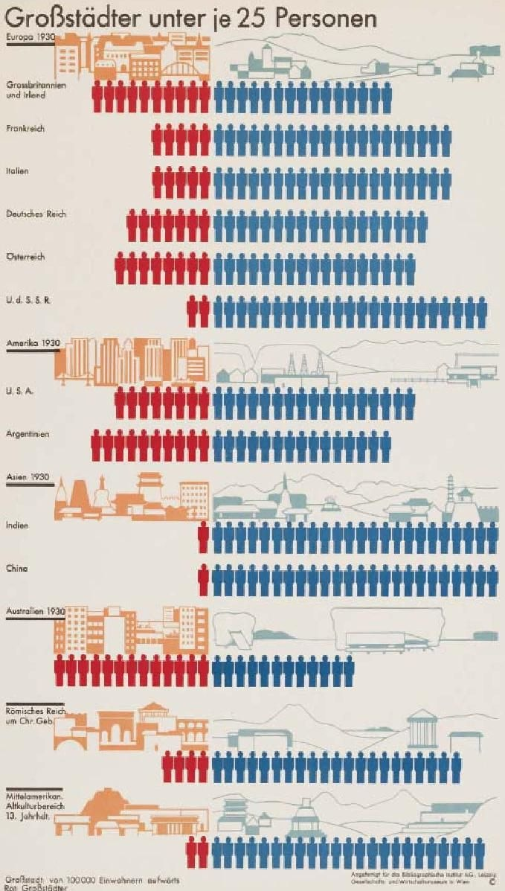

# 每 25 人中的大城市居民

| 判断层 | 归类与依据 |
|---|---|
| 01 基础逻辑 | 编目型。按国家或历史区域组织条目，每行重复同一指标。 |
| 02 主表现标签 | 比较型。统一每行 25 人，比较大城市居民所占份额。 |
| 03 专项身份 | 历史案例，属于后来发展为 ISOTYPE 的维也纳图像统计法。 |

## 图形与视觉编码

红色为大城市居民，蓝色为其余居民。脚注以人口 10 万及以上界定大城市。每行用 25 枚等大人形表现整体，红色从分界向左排列，蓝色向右排列。两色的交界固定，方便纵向比较。同样大小的图符通过数量表达份额，每枚相当于 4 个百分点。橙色城市轮廓与蓝绿色景观帮助识别左右两侧的概念，建筑数量无对应统计值。

## 信息结构与阅读

先读标题和统一分母，再逐区比较 1930 年的展示对象，最后读罗马帝国和中美洲古代文化区两条历史对照。历史条目与现代条目是不同样本，排列用于对照。

## 数据及制作步骤

[基础数据 CSV](基础数据集.csv) · [数据字典](数据字典.md)

表中有 13 条对象记录。例如，大不列颠与爱尔兰为 10 枚红色图符，即图示比例 40%。澳大利亚为 13 枚，即图示比例 52%。这些是图面换算，精确原始统计待查。

重绘时可先确定居民定义及比较分母，再把比例换算为可重复图符。为红蓝两组设置共同分界、等尺寸及等间隔。最后检查各行分母、标签和时期，说明取整精度。

## 出处

同题图版见书展目录所载《Gesellschaft und Wirtschaft》，莱比锡 Bibliographisches Institut，1931 年。图中 1930 为现代比较数据时期。案例图片由用户提供，图版再发布权属待核。

[书展目录与同题图版](https://ilab.org/assets/documents/articles/documentation_center_files_1960_katalog_2017_20stuttgarter_20antiquariatsmesse.pdf)
