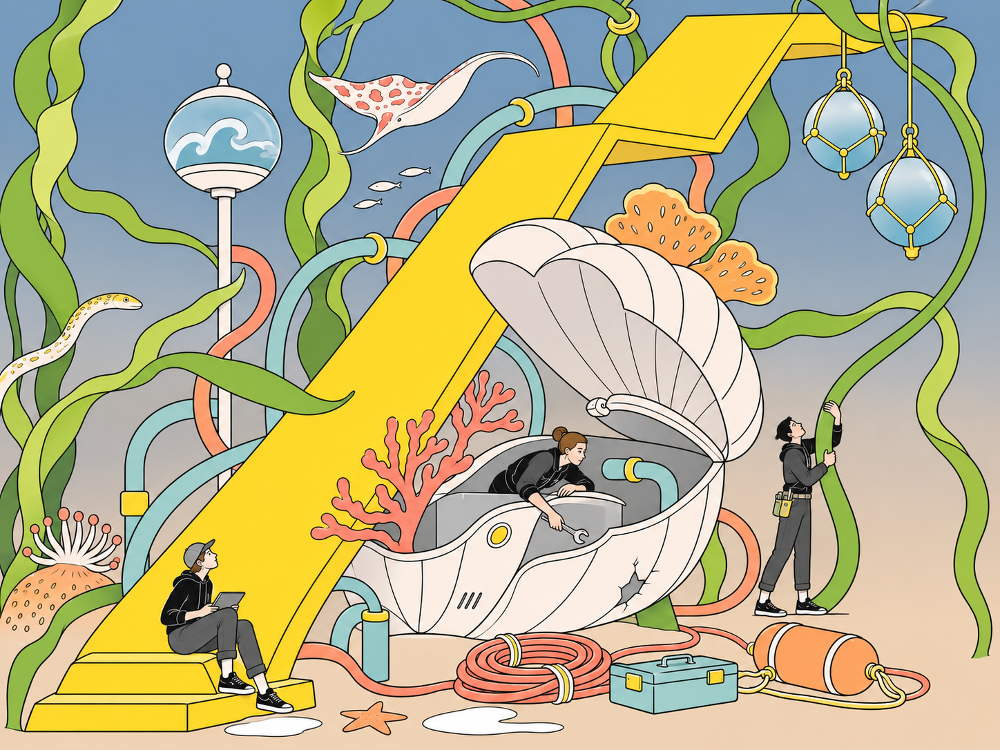

# 超现实平涂插画风格分析与克隆案例



档案 **surreal-flat-organic-scene v1.0** · StyleClone 1.0 · 单图提取与新主题迁移

原图以一条黄色大斜面建立第一焦点，让绿茎和藤蔓反复横穿，再用小人物的日常动作带出尺度反差。新图将这套组织关系转到《潮汐信号维修站》，通过两轮生成检查组织关系能否随题材一起迁移。

- [原始参考 R1](reference.jpeg) · [首稿 V1](draft-01.png) · [修订稿 V2](preview-02.png)
- [风格档案 JSON](profile.json) · [任务绑定 JSON](task.json)
- [四版实例提示词](四版提示词.md) · [四版可换主题母版](四版母版.md)
- [首稿实际提示词](首稿实际提示词.txt) · [修订稿实际提示词](修订实际提示词.txt)

## 1. 接单与来源

R1 为用户上传的 JPEG，原文件名为 `Masha_Krasnova-Shabaeva.jpeg`，1200 × 905。用途为画法与视觉关系参考。作品标题、原始发表出处、作者署名及转载授权未独立核验，文件名仅用于定位来源。结论适用于这一个画面，实际绘制媒介和同作者其他作品的共同特征待核。

本案按 Terra [系统正文](../../SYSTEM.md)和[工作流程](../../Terra工作流程.md)执行。方法基线为 Terra 提交 `ee518bb4977e621df95873efcef3ebc59b3818ad`。用户委托提取画法、迁移并审阅后归档。本次示范主题、横幅和无字规格为设计选择。

## 2. 判断信息关系

图面通过大型植物、椭圆形物件和小人物建立想象场景。人物动作、物体尺度和互相遮挡构成叙事。时间、层级、字母、地点和可逐项检索的目录均未承担整体组织。按普通插画分支处理，五类数据逻辑与统计图形标签记为不适用。

## 3. 核对数据与编码

本案无统计尺度、数据图例或量化映射。大小承担场景中的比例反差，颜色承担对象区分和注意力分配。原图上的服饰图案作为局部视觉证据。三位维修员与 4:3 画幅为新任务的核对项。

## 4. 逐图观察与十三项提取

**第一眼**落在从上中部接近右侧斜贯到左下的黄色长面。**第二眼**在中腹的椭圆、裂口和露出的人之间移动。**随后**可沿两侧弯茎看到左上的人物与莓果、右侧下垂花形和右下的有斑点生物。斜轴和弯曲的植物边缘提供多条回看路径。

| 系统与规则 | R1 可定位的事实 | 对画面的作用与可变边界 |
| --- | --- | --- |
| A1 风格本体 · S01 | 全图由一块长黄色斜面、跨区绿茎和小人物组成。 | 直与曲交错，平面画法承载超现实内容。主题物件可以换，主要方向和明确遮挡仍有作用。 |
| B1 色彩 · S02 | 黄色聚于斜面，绿色贯穿两侧。珊瑚红、橙、湖蓝和白散布在果实与椭圆群上。 | 将最醒目的色集中，连接色复现，辅色分散。右下生物也用黄，因其带斑点、面积较碎，和主斜面构成呼应。 |
| B2 光线 · S03 | 上方灰蓝，向底部逐渐转暖。主体以平涂为主，右侧花形与小水滴有局部软变化或亮斑。 | 背景提供氛围和前后关系。没有充分证据判定统一光源的方位。 |
| B3 空间构图 · S04 | 左上人物搭在斜向绿茎上，右侧弯茎遮住部分人形，中腹多个椭圆发生重叠。 | 依靠遮挡、接触与方向连续性组织空间。构图可以重新位移，动作所需的支撑和前后关系应读得出来。 |
| B4 尺度 · S05 | 左上莓果接近俯身人物躯干的视觉尺度，下方椭圆比可见人物面积大。 | 小人物提供尺度参照。人与巨物要能直接比较，无需设定跨主题的绝对倍数。 |
| C1 绘画语言 · S06 | 近黑细线围出叶、衣服、人体和椭圆。叶脉及褶皱用内部细线。 | 先靠轮廓和色块认形，再读细节。线宽可按画幅调节，避免内线压过剪影。 |
| C2 边缘 · S07 | 人物、叶和黄色斜面多为硬边，右侧垂挂的蓝色花形内部有柔过渡。 | 主轮廓清楚。仅在需区分表面转折的附属形体上启用柔过渡。 |
| C3 完成度 · S08 | 中腹裂缝、人物手脚、脸和植物的接触处可辨，白色椭圆保留大片色面。 | 把描绘集中到识别或动作所需部位。降低次要区域的零件数量，减少竞争焦点。 |
| C4 材质纹理 · S09 | 左上果实有短小种籽线，中腹部分椭圆有斑点，右下生物有黑斑。 | 纹理附着于特定对象并区分表面。参考图仅支持观察到的图案，媒介的颗粒和印刷工艺待核。 |
| D1 主体设计 · S10 | 左下有人坐靠，上方有人攀伏，中央有人探出椭圆开口。 | 用自然姿态建立可信度，将异常感放在大小、场景和生物化细节上。动作可以换为主题所需的可见接触。 |
| E1 信息密度 · S11 | 中腹及边侧聚集小元素，斜面、椭圆空白和背景间隙提供低密区域。 | 密处供探索，简处让视线停顿。增加对象后应重查首焦点和必要间隙。 |
| E2 视觉锚点 · S12 | 高饱和黄色长面清晰完整，邻近的白色椭圆和局部人脸形成小落点。 | 首焦点主要靠面积、方向和色彩，次焦点靠局部反差及人的动作。 |
| E3 视觉张力 · S13 | 冷暖背景、斜直与弯曲、巨物与小人物、平静面孔与异常环境同时出现。 | 日常姿态使场景的离奇感更突出。叙事张力依靠成对关系，可调整各对象的具体位置。 |

## 5. 反事实检查与规则分级

| 检查 | 预期验法与失败征象 |
| --- | --- |
| 替换物件 | 把斜面、藤茎和椭圆群依次替换为折角信号板、海藻管线和检修舱。缩略观看仍能找到斜轴、穿插和尺度对比，支持这些关系具有迁移价值。 |
| 破坏关系 | 若将黄色均摊到多件设备，或把绿色曲线退到图框边缘，缩略观看时斜轴优势或跨区穿插会减弱。若给全图加统一重阴影，大色面与细线的风格特征会被压低。以上是从单图提取的判断，尚无跨题材系列实验。 |

核心规则包含斜轴与有机曲线、色彩角色、遮挡和尺度、细线平涂、动作与异常环境的对照。附属物件的软过渡是条件项。三位维修员的位置、动作、横幅和无字是本次任务锁定。局部表面图案、具体物件形状、次要小生物和裁边可随主题重组。

## 6. 建档

[profile.json](profile.json)记录十三个模块、双语规则、定位证据、角色槽位、条件、优先级、依赖和验法。档案的 `core` 为本例风格提取判断，`must` 为当前生成优先级。后续要改变核心关系时建立派生版本。

## 7. 绑定新主题

| 图面作用 | R1 的承担者 | 本次角色绑定 |
| --- | --- | --- |
| 第一焦点与导视 | 明黄色长斜面 | 从画面左下斜指右上的黄色折角信号板 |
| 连接和遮挡 | 弯茎与垂挂花叶 | 宽窄不一的绿海藻及柔性管线 |
| 第二焦点与叙事动作 | 部分椭圆与人物探身 | 右下偏中的白色扇贝检修舱及开舱动作 |
| 人体给出尺寸参照 | 坐靠、攀伏与窥视的人 | 三位维修员，分别坐在基座、从白舱探身、扶住右侧绿管线 |
| 附属物表现局部柔过渡 | 蓝色花形内部 | 右上两枚浅蓝浮标的表面 |
| 环境与节奏 | 上蓝下暖的空隙 | 海底站灰蓝至沙米色背景，次要物件用珊瑚红、湖蓝、浅橙 |

[task.json](task.json)记录当前对象、规格及条件取值。少量小鱼和珊瑚是画面辅助内容，可随背景密度收放。

## 8. 编译与制作

在 `07-风格分析与克隆系统` 内执行以下命令。第一条生成母版，第二条生成新主题实例。现存 [四版实例](四版提示词.md)与[四版母版](四版母版.md)由同一档案编译。

```sh
python compile_prompts.py '案例研究/CASE-0001-超现实平涂插画/profile.json'
python compile_prompts.py '案例研究/CASE-0001-超现实平涂插画/profile.json' '案例研究/CASE-0001-超现实平涂插画/task.json'
```

制作顺序为先立黄色斜轴和白舱两个焦点，再加三位维修员和其接触处，随后让绿海藻与管线在各层交错，最后放入局部图案与辅助物件。生成服务为 OpenAI 图像生成，具体模型版本、种子、参考强度未返回，记录为 `null`。首稿读取 R1，修订稿以首稿为编辑目标、R1 为疏密和平涂程度参考。两次实际文本均保留在本目录。

## 9. 验图与修订

[V1](draft-01.png)的主斜轴、人物位置和二级白舱成立。偏差集中在左侧气象塔的栏杆和密集接头、右侧鱼群、底部碎石及白舱内设备。左右与底部多处同时出现高细节，和参考图的空白间隙及局部细节策略有距离。V2 仅请求简化次要机械形和背景细节，保护主构图、角色数量、三组接触动作、颜色角色及无字条件。

| 验收维度 | V2 判定 | 图面核验 |
| --- | --- | --- |
| 风格 | 核心通过，条件项待收敛 | 黄色斜面仍先入眼，绿海藻前后穿插，细轮廓和简化色面成立。左塔栏杆、底端碎石基本收掉，人物右侧留出背景间隙。白舱仍有较强灰面分层，左侧仪表罩也保留局部软光，超出 S07 在本次仅指定右上浮标的局部范围。 |
| 内容 | 通过 | 黄色信号板、白舱、珊瑚色线缆卷、青色盒及橙色浮筒可辨。左下坐姿、舱中探身、右侧扶握动作各一处。 |
| 锁定项 | 通过 | 三位维修员呈任务所定位置与动作，无可读文字与标识，横幅符合任务。 |
| 图文结构 | 通过 | 无字画面中，斜板与检修舱依靠方向、面积和明度获得主次。 |
| 技术交付 | 通过 | 首稿和修订稿均为 1448 × 1086 PNG，4:3。 |
| 系列一致性 | 未验证 | 本案为单个主题的两轮生成，未做独立第二题材、增加对象或改画幅的系列检查。 |

V2 为归档展示样图，保留上述偏差。若继续校正，最小修改区域为左侧仪表罩与白舱内侧，将其柔反光或层级阴影减少，复核舱口和扳手的可读性。当前样图不作为已通过跨主题验证的基线。

## 10. 回写与复用

换主题时保留 [profile.json](profile.json) 的角色说明，另写任务绑定，重编四版并复核视觉锚点、尺度、接触与留白。整个案例从 [07 模块入口](../../README.md)检索。
