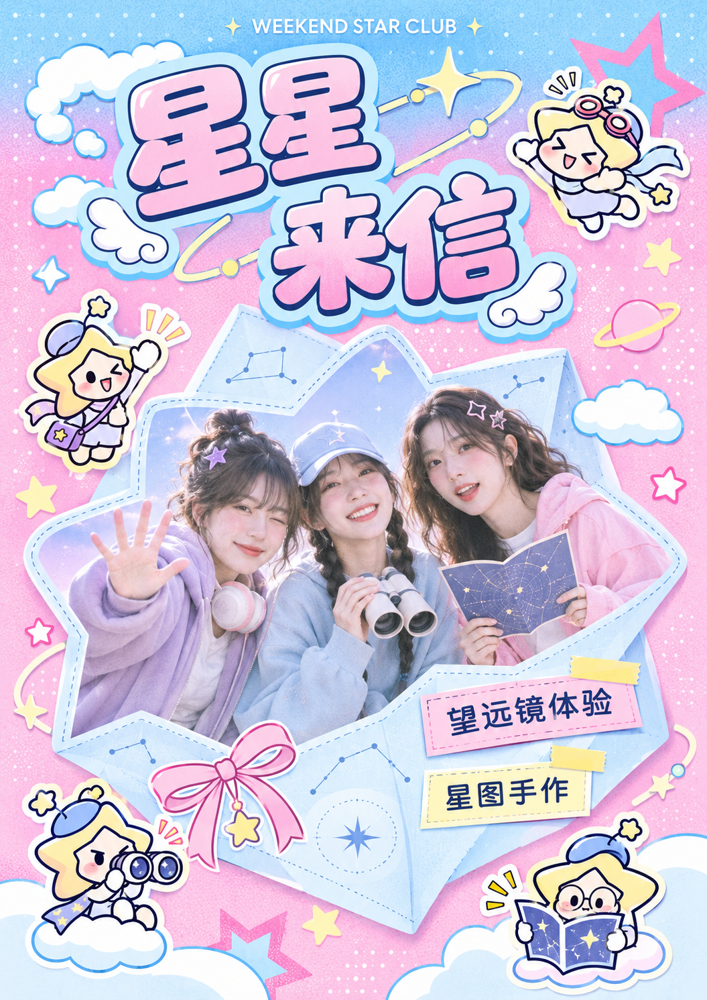

# 粉蓝照片贴纸拼贴海报风格分析与克隆案例



- [原始参考图 R1](reference.jpeg) · [《星星来信》样图](preview.png)
- [风格档案 JSON](profile.json) · [任务绑定 JSON](task.json)
- [四版实例提示词](四版提示词.md) · [四版可换主题母版](四版母版.md) · [实际生成提示词](实际生成提示词.txt)

档案 `pastel-photo-sticker-event-poster` v1.0 · 任务 `stars-send-letters`

## 1. 建立分析基线

Terra 当前 `main` 提交为 `24eaee84965c7be56e5711af801172b73aa7f6dc`。根目录 `AGENTS.md` 指向 `07-风格分析与克隆系统/SYSTEM.md`，本案也使用同目录的《Terra工作流程》。

[R1](reference.jpeg) 为用户上传的 Bunnies Day Cafe Event 海报 JPEG，1080 × 1528，作为风格参考。画面可见活动题头及 NewJeans 字样，制作者、发布出处和公开转载授权待核。以下分析针对这张作品。使用磨砂、颗粒、纸张等表述时描述可见质感，实际工艺待核。

## 2. 判断作品类型

这是粉蓝照片贴纸拼贴风格的活动宣传海报。顶部说明活动，上部大标题吸引目光，中部照片说明人物主题，下部纸件与短文案完成邀请。照片和文字以版面层级组织，因此按非数据海报分支处理。

## 3. 核对数据逻辑

年份 2025 是活动题头内容。图中没有依时间排列的多条记录，也没有通过图符数量、颜色、长度计算或比较统计量。五类信息图数据逻辑、统计图形和 CSV 数据接口记为不适用。照片人数、贴纸数、文案与画幅在本次新任务中可明确锁定。

## 4. 从整体到局部观察

整体视线路径为上部的粉色韩文大字 → 中部心形照片的脸 → 下部浅蓝信封与蝴蝶结 → 边角不同表情的贴纸。顶部英文是一行小字，信息明确，视觉权重小于大标题。云朵、星星和音符在边缘连接各块内容。

| 模块 | R1 图面证据 | 组织作用及迁移边界 |
| --- | --- | --- |
| A1 风格本体 · S01 | 色块字、真人粉调合照、深线平涂角色与信封拼贴同页出现。 | 字与角色带来手账感，摄影说明活动相关人物。换主题时仍可使用三类媒介的反差。 |
| B1 色彩 · S02 | 天蓝从顶端过渡到粉底，淡蓝信封占下半部，浓粉在字形、心形边与小图标上反复出现。黄绿见于小星星和贴纸外缘。 | 浅粉天蓝是两块大色面，深色描边让文字清楚，少量黄绿提供局部变化。 |
| B2 光线 · S03 | 照片脸部较亮、阴影柔和，纸件边有浅而短的明暗差。 | 照片和底图色温接近，接触阴影提示谁压在谁上面。图面不足以判断拍摄灯位。 |
| B3 空间构图 · S04 | 五人照片被心形轮廓裁切，信封折页压在照片下半部，蝴蝶结与标签覆盖信封。 | 遮挡将照片、纸件、标签连成一件正在拆开的邀请物。主题可换成其他有明确开口或折页的纸件。 |
| B4 尺度 · S05 | 大字与照片面积最大，五枚角色贴纸小一档，星星、音符和小卡再小一档。 | 同一页容纳多种元素时先由尺度建立优先级，角色数量和各图形像素尺寸可随主题改变。 |
| C1 绘画语言 · S06 | 粉色字块错落排布。兔耳角色以深线和平涂建形，照片保留五官、发丝和衣褶。 | 字可以倾斜与局部夸张，同时保护单字结构。插画以简化和表情见长，摄影保留真实质感。 |
| C2 边缘 · S07 | 大字深色内描边外包宽浅蓝边，下方可见错位蓝边。角色外缘有浅黄、粉、绿、蓝的模切边。 | 大字硬边方便快速识读，角色外缘负责分开贴纸和背景。外边宽度取决于画幅与字级。 |
| C3 完成度 · S08 | 五官、字形和信封折角可辨，星星与云朵多为简形。 | 细节集中在谁参加、活动叫什么、纸件如何组装。小装饰无需增加大量内线。 |
| C4 材质纹理 · S09 | 背景可见颗粒、规则浅圆点和粉蓝渐变。部分反光或彩点只在局部出现。 | 弱纹理让大铺色不显空，均匀背景点纹与自由拼贴形成节奏。保护字形和面孔的清晰度。 |
| D1 主体设计 · S10 | 角色反复出现兔耳帽、大头小身、腮红及夸张动作，照片服饰也使用粉色。 | 同一家族靠轮廓语法重复形成一致性。换主题时重新设计角色形状、衣物与动作。 |
| E1 信息密度 · S11 | 贴纸在左右边与底角聚集，较小符号填补部分间隙，题头、面孔和大字周围仍可读。 | 边缘密处便于发现小细节，主要信息附近疏一些。排布可随字数、人物尺寸调整。 |
| E2 视觉锚点 · S12 | 深边粉字先吸引目光，照片里的脸形成第二落点，右下两枚色纸条承担补充短句。 | 从识别主题到看人，再读邀请信息。无补充文案时将短标签条件关闭。 |
| E3 视觉张力 · S13 | 真人表情和夸张的卡通姿态并置，斜排大字和规则圆点并置。 | 真实与想象两种语气同时存在，形成俏皮的邀请感。 |

## 5. 规则分级与反事实检查

核心关系为粉蓝大色面、两级主焦点、照片与纸件交叠以及深线浅边的角色组。若把主图平铺在背景上，撤掉纸件窗口和压边，即使用同一组颜色，邀请卡的开合感也会消失。若给角落贴纸放大到主照片附近的尺度，标题、主图和贴纸会彼此抢焦。

替换主题时，可以将心形信封换成星芒星图卡、兔耳角色换成一组星星角色，继续查看焦点和遮挡能否读出。照片人物身份、具体轮廓、角落饰件和文字内容均可随主题重设。本次锁定三位虚构成年人、四枚星星角色、四组准确文字和 A 系列竖幅。短标签是按主题启用的条件。以上是单图提取后用单一新主题进行的检验。

## 6. 建立复用档案

[profile.json](profile.json)记录版本、十三个模块、双语规则、证据位置、条件、槽位与验法。[四版母版.md](四版母版.md)保留角色槽位。需要换主题时使用原档案并新建任务绑定。

## 7. 主题绑定《星星来信》

本次创作采用虚构的周末观星手作会。主题及物件为本次设计选择。

| 图面功能 | R1 承担者 | 本次承担者 |
| --- | --- | --- |
| 首焦点 | 错落两行韩文贴纸字 | 两行粉色泡泡字「星星」「来信」 |
| 识别活动及人物 | 小号英文题头与五人合照 | WEEKEND STAR CLUB 与三位虚构成年社员 |
| 承载主体图像 | 心形照片与浅蓝信封 | 圆角星芒开窗的淡蓝折页星图卡 |
| 边缘节奏 | 兔耳角色、音符、星星 | 四枚不同动作的拟人星星贴纸、云朵、轨道线 |
| 次级信息 | 右下两枚短句纸条 | 「望远镜体验」「星图手作」 |

## 8. 编译与出图

[task.json](task.json)定义任务内容。[四版提示词.md](四版提示词.md)依次是中文 JSON、英文 JSON、中文简版与完整自然语言版。两份 JSON 字段、ID、优先级和顺序已核对，四组文案跨版本保留。四版母版和实例可用 Terra `compile_prompts.py` 重建。

制作顺序为先画粉蓝背景和纸件骨架，再摆标题与照片，再压入折页叠边，最后补角色贴纸和短标签。实际生成使用 R1 和[实际生成提示词](实际生成提示词.txt)，出图为[《星星来信》](preview.png)。生成模型具体版本、种子和参考权重未返回。

## 9. 样图验收

| 维度 | 结果 | 核验点 |
| --- | --- | --- |
| 风格 | 核心通过，局部有偏差 | 首眼先见粉色大字，照片为第二焦点。深轮廓、浅模切边、粉蓝色场和中央纸件叠压清楚。字面高光和背景闪点强于 R1，黄色贴纸也更醒目。 |
| 内容 | 通过 | 三位社员、淡蓝星图卡、四枚星星角色和两个活动小标签都能辨认。器物与场景围绕观星主题。 |
| 锁定项 | 通过 | 核对四组文案、三位成年人物、四枚角色及 A 系列近似比例。未见额外活动信息。 |
| 图文结构 | 通过 | 上方标题先读，主要脸部无贴纸盖住，右下文字虽然较小仍清楚。 |
| 技术交付 | 通过 | 单张 PNG，1055 × 1491，接近 1:√2。 |
| 系列一致性 | 未验证 | 当前只验证了活动海报这一种新主题。 |

若以贴近 R1 的平涂质感为目标，后续只需压低大字高光和背景白色闪点，让附属贴纸的浅黄略回退。现样在主次、文案和主题上已达审阅要求。

## 10. 归档与复用

本案经用户审阅后归档。换主题时可保留风格档案，重新分配标题、照片、纸件和角色贴纸。是否启用补充纸条由新主题决定。若要扩展成系列，逐张检查标题和照片的优先级、边缘密度和实际文案。

在 [07 风格分析与克隆系统](../../README.md) 目录运行以下命令，分别重建母版与本次实例。

```sh
python compile_prompts.py '案例研究/CASE-0002-粉蓝照片贴纸拼贴海报/profile.json'
python compile_prompts.py '案例研究/CASE-0002-粉蓝照片贴纸拼贴海报/profile.json' '案例研究/CASE-0002-粉蓝照片贴纸拼贴海报/task.json'
```
