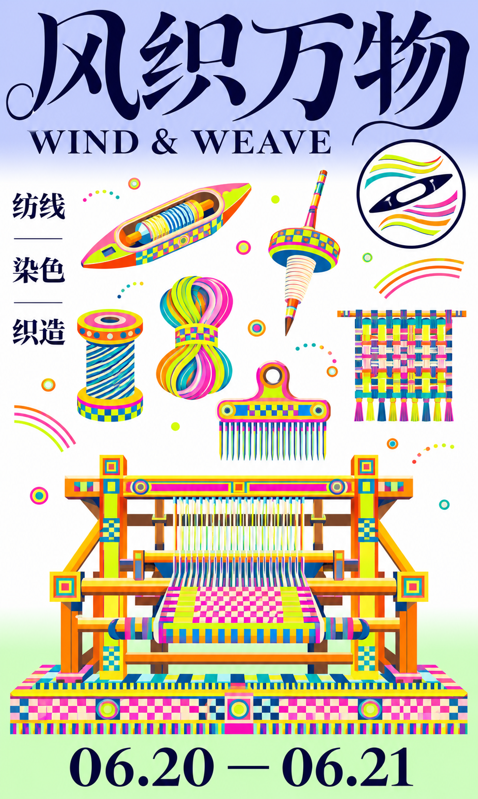

# 高饱和几何纹样文化节海报风格分析与克隆案例



- [原始参考图 R1](reference.png) · [《风织万物》迁移样图](preview.png)
- [风格档案 JSON](profile.json) · [任务绑定 JSON](task.json)
- [四版实例提示词](四版提示词.md) · [四版可换主题母版](四版母版.md) · [实际生成提示词](实际生成提示词.txt)

档案 `ornamental-geometry-culture-poster` v1.0 · 任务 `wind-and-weave-open-day`

## 1. 建立分析基线

本次读取 Terra `main` 提交 `51d1787557701c26c4ca3dfb1e86a6591ab95c85` 的根目录入口 `AGENTS.md`、`07-风格分析与克隆系统/SYSTEM.md` 和《Terra工作流程》，按 StyleClone 1.0 执行提取、迁移、出图及验收。

[R1](reference.png) 为用户上传的 2026 K-Royal Culture Festival 春季海报，1228 × 2048 PNG，约 3:5。作品标题按图面转录。设计者、首发页面及图像的公开转载许可未独立核验。分析限于这张图上可观察到的视觉组织。

## 2. 判定作品类型

主类型为文化活动宣传海报。大标题呈现活动名称，英文副标题和季节徽记辅助识别，左侧短列和底部日期提供到访信息，中部器物与下部宫殿表达题材。左侧局部具有编目式组织，可逐条查找地点；全图的主体仍按宣传海报的图文层级阅读。

## 3. 核对信息与数据逻辑

左侧六组场地依次包括景福宫、昌德宫、德寿宫、昌庆宫、庆熙宫与宗庙，每组用韩文、汉字、英文叠排。主日期与季节标志是活动元数据。图中器物之间的间距、圆点数量、色彩和纹样密度没有量化图例，统计图形与 CSV 编码在本案中不适用。

## 4. 观察阅读顺序与十三项风格

第一眼看到顶部深墨蓝大字。此后视线沿中部器物和彩点向下，到达宫殿及底座，再读主日期。寻找场地时，可以切换到独立的左侧栏。右上椭圆徽记标示季节，并在不占据中轴的位置形成侧向落点。

| 模块 | R1 可见证据 | 作用与迁移方法 |
| --- | --- | --- |
| A1 风格本体 · S01 | 上部大字书写感强，中间明艳器物几何化，下部建筑纹样密集。 | 字与图有两种语气。传统语感由字形和题材提供，现代感由模块色块、留白和几何组形提供。 |
| B1 色彩 · S02 | 浅紫蓝顶端渐隐到白，底部渐入浅绿。墨蓝统一主文字，亮绿、橙、蓝、粉集中在对象。 | 把暗字、浅底和艳色图形分角色。当主题变化时先保护角色，再决定各器物具体用色。 |
| B2 光线 · S03 | 大部分形体平涂，个别器物有圆柱端面、薄侧面和相邻深色。背景柔和过渡。 | 主要靠相邻色面表达转折，背景可用渐变。保留少量浅层体积便于认形。 |
| B3 空间构图 · S04 | 页顶字块横贯，中段器物悬浮错落，下部宫殿沿中轴落稳，底端另设信息带。 | 先划分上、中、下和页脚四区，再排各区对象。左栏服务检索，居中的底座为画面定重心。 |
| B4 尺度 · S05 | 标题和宫殿大；扇形件、悬挂件等居中；彩环和点链小。 | 三级尺度分别负责先读、浏览和串联，控制小装饰的视觉重量。 |
| C1 绘画语言 · S06 | 物件以圆、扇、条、方几何拼接，建筑用重复条带组成屋顶、窗格和平台。 | 先保留外形线索，再用同一组几何基元装饰不同对象。 |
| C2 边缘 · S07 | 标题有粗细反差和钩状、回绕收笔；器物用锐边、套边和局部点边。 | 标题使用有表现力的字形，图形提高边界精度；硬边把多色从白底中分离。 |
| C3 完成度 · S08 | 宫殿窗格、屋檐和底座高度细化，漂浮器物保留识别特征，文字周围相对干净。 | 细节限于器物和构件内部，主信息区仍有清晰边界。 |
| C4 材质纹理 · S09 | 可见细条纹、棋盘格、点列与同心环，大片区域为干净平涂。 | 通过规则重复建立表面纹理，媒介、真实印刷工艺与作者工具待核。 |
| D1 主体设计 · S10 | 中部有悬挂件、扇形物、弦乐器形与鼓形物，周围有独立圆点与弧线。 | 保留每件器物的识别轮廓，装饰记号只负责连接与穿插。 |
| E1 信息密度 · S11 | 图案最密处在器物内部和底座，器物间大面积白地，地点按独立窄列排版。 | 将复杂度收进轮廓，留出一条能连续扫读的白地和信息栏。 |
| E2 视觉锚点 · S12 | 大标题先入眼。中部彩器与下部宫殿逐级承接，日期位于底端。 | 以文字开启阅读，以主图推进，以日期收束。 |
| E3 视觉张力 · S13 | 深蓝字庄重，彩色器物轻快。上方散开的器物与下方稳定中轴并置。 | 同时控制动静、密疏和字图语气，保持庆典活力。 |

## 5. 核心规则与反事实核验

核心由四种关系组成：表现性暗色标题与鲜艳几何器物；器物间白地与器物内部高纹样密度；中部散点与底部宽底座；形体识别线索与重复模块。若将纹样铺满白地，器物剪影会失去间隔。若撤掉宽底座，漂浮区会缺少下部的视觉重量。这两个反事实在构图上可检验，当前只做了一个新主题的迁移。

窄栏是可选条件。具体题材、语言、日期和场地数量可换。新样锁定六种器物各一个、底部织机、六组文案和约 3:5 竖幅。

## 6. 建立可复用档案

[profile.json](profile.json)含版本、十三项规则、来源定位、双语描述、角色槽位、优先级、依赖与验法。[四版母版](四版母版.md)保留角色槽位，用于新任务。

## 7. 绑定新主题《风织万物》

以虚构的织造开放日测试风格迁移。活动日期仅为本次创作设定。

| 图面功能 | 原图 | 新样图 |
| --- | --- | --- |
| 第一入口 | 墨蓝韩文大字、英文衬线副标题 | 中文「风织万物」、英文 WIND & WEAVE |
| 中段浏览 | 彩色宫廷题材器物和彩点 | 梭子、纺锭、线轴、绞纱、针梳、编织样片 |
| 下部重心 | 宫殿正立面与重复纹样平台 | 正视木织机与织带平台 |
| 窄栏与页脚 | 六组场地与主日期 | 「纺线」「染色」「织造」与 06.20 — 06.21 |
| 侧向落点 | 椭圆春季徽记 | 无字的穿梭波纹圆徽 |

## 8. 编译与制作过程

[task.json](task.json)建立本轮主题绑定。[四版提示词](四版提示词.md)依次为中文 JSON、英文 JSON、中文简版和完整自然语言版。通过仓库编译器复核母版与实例，两种语言的规则 ID、优先级、组别和顺序一致。

先排标题、侧栏、页脚和白色中段，再确定织机中轴与平台宽度，放入六件彼此分开的器物，最后让棋格、条带和色环在各物内部复用，并用疏散点链衔接间隙。[《风织万物》样图](preview.png)使用 R1 与[实际生成提示词](实际生成提示词.txt)制作。模型版本、种子和参考权重未返回。

## 9. 样图复核

| 维度 | 判断 | 图面依据 |
| --- | --- | --- |
| 风格 | 核心通过，局部有偏差 | 深墨蓝大字、近白漂浮区、浅紫蓝至浅绿的背景和宽底座均可辨。梭子内槽、织机的斜撑和横梁用了较深侧面，立体感强于参考图整体的平涂观感。 |
| 内容 | 通过 | 白色区域可辨六件器物，织机经线与成布相接。右侧圆徽内另有一个简化梭形符号，应作为徽记阅读。 |
| 锁定项 | 通过 | 逐项核对「风织万物」、WIND & WEAVE、「纺线」「染色」「织造」与 06.20 — 06.21。六件独立器物分别出现。 |
| 图文结构 | 通过 | 标题、器物、织机与页脚顺序清楚，窄栏可单独阅读。 |
| 技术交付 | 通过 | 单张 PNG，971 × 1619，约 3:5。 |
| 系列一致性 | 未验证 | 目前只验证织造主题。 |

若继续缩小与原图的差异，可只压平梭槽、织机斜撑和横梁的暗面，保留经线、器物间距和标题。六件器物指六个独立插画，右侧徽记中的抽象形属于装饰标记。

## 10. 归档与复用

本案经用户审阅后归档。换主题时可沿用标题、器物区、下部主体和页脚的层级，重新设定器物剪影、纹样与文字。信息栏按活动需要启用。更换画幅或增加器物后，检查白地是否连通、底座是否稳住重心，以及主要文字能否独立阅读。

在 [07 风格分析与克隆系统](../../README.md) 目录运行以下命令，分别重建母版和本次实例。

```sh
python compile_prompts.py '案例研究/CASE-0004-高饱和几何纹样文化节海报/profile.json'
python compile_prompts.py '案例研究/CASE-0004-高饱和几何纹样文化节海报/profile.json' '案例研究/CASE-0004-高饱和几何纹样文化节海报/task.json'
```
