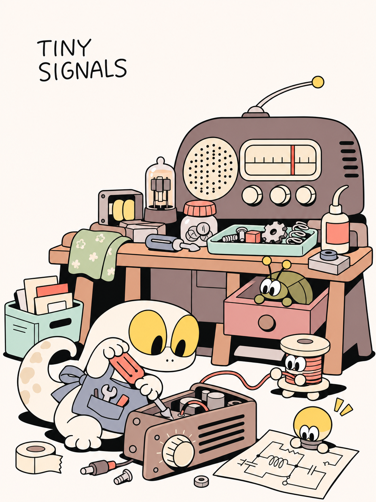

# 低饱和手绘角色群像风格分析与克隆案例



- [原始参考图 R1](reference.webp) · [首稿](draft-01.png) · [修订稿](preview-02.png)
- [风格档案 JSON](profile.json) · [任务绑定 JSON](task.json)
- [四版实例提示词](四版提示词.md) · [四版可换主题母版](四版母版.md)
- [首稿实际提示词](首稿实际提示词.txt) · [修订稿实际提示词](修订实际提示词.txt)

档案 `muted-flat-mascot-vignette` v1.0 · 任务 `tiny-signals-radio-workshop`

## 1. 建立分析基线

本次从 Terra `main` 提交 `09f187516964c531b5c20103c918fd4d1c3523f8` 读取根目录 `AGENTS.md` 指定的 `07-风格分析与克隆系统/SYSTEM.md` 和《Terra工作流程》。按 StyleClone 1.0 执行提取、迁移、出图、修订和复核。

[R1](reference.webp) 为用户上传的《ART OF MISSING》WebP 插画，1486 × 2010。标题按图面转录，原始发表来源、设计者和公开转载许可未核验。「手绘感」用于描述笔线与字形外观，实际使用工具待核。分析范围限于这张作品。

## 2. 判定作品类型

这是以画室为场景的角色群像插画，也可用于吉祥物的世界观展示。左上是题头和小段文字，插画通过上下层叠与角色动作提示阅读，绘画道具把各个小情节串到同一场景中。它展示的是角色在情境中的表现。

## 3. 核对信息逻辑

五类数据逻辑、统计图形及 CSV 接口在此案中不适用。画中的方位指针、颜料数量、箱内角色数量与大眼比例属于场景设计，缺少量化编码与图例。迁移任务单独锁定一位主角、三组配角、标题和画幅。

## 4. 观察阅读顺序并拆解十三项

前景主猫的黄眼和珊瑚红大铅笔有较强的颜色与尺度对比，吸引视线落到手里的动作。之后可顺着画纸、箱子、画架和桌沿回看中层，在偏右上方的灰色大胸像暂时停顿。左上手写标题和小说明独立占有纸白，提供另一个阅读入口。

| 模块 | R1 可定位证据 | 作用与迁移办法 |
| --- | --- | --- |
| A1 风格本体 · S01 | 圆润小角色、画架与桌面、巨大灰雕像共同叠在暖白底上。 | 以「主角动作—工作区—大场景物」形成三层叙事，题材可替换。 |
| B1 色彩 · S02 | 大面积暖白、灰褐，中层有低饱和薄荷和橄榄色；黄眼与珊瑚红铅笔集中在前景。 | 以低饱和色区分配景，少量黄色与珊瑚红配合做焦点。 |
| B2 光线 · S03 | 桌下、脚后和盆栽后是纯黑硬边形，人物和道具内部主要平涂。 | 黑色主要说明落地、叠压和遮蔽。光源方向证据不足，不推定精确灯位。 |
| B3 空间构图 · S04 | 后方雕像偏右，中段工作台横向连接，主角色在前景下方，顶部保留空白。 | 先架前中后景，再用压叠关系分层，左上留给题头。 |
| B4 尺度 · S05 | 主猫头大、四肢短，双手抱着长过躯干的铅笔；箱内小角色更小。 | 用单个超大工具强化动作，配角按实际视觉重量降一级。 |
| C1 造型笔线 · S06 | 主体弧线清楚，内线简化成衣褶、短排线和转折；盒、桌较方。 | 圆曲线画角色，直线和折线搭台，内线只在有用位置出现。 |
| C2 边缘 · S07 | 轮廓清晰，箱沿遮住身体，桌沿与挂布交叉。 | 用硬边、相交处省略和黑色贴地影表现前后。 |
| C3 完成度 · S08 | 前景眼睛、手和笔尖清楚；背景胸像大部分保持一整块灰。 | 把细节留给表情、工具接触和关键转折；后景大形减少内部描绘。 |
| C4 材质 · S09 | 布面小花、箱体短排线和木质分面局部出现，暖白底大体平整。 | 材质靠稀疏标记、结构和色块暗示，避免全面叠颗粒。 |
| D1 角色设计 · S10 | 几只小角色分别探头、执笔、看画。调色板和盆栽花朵也被赋予眼睛。 | 角色各有可指认的小动作，可用眼睛和姿势让少数道具融入同一情境。 |
| E1 信息密度 · S11 | 横桌和前景聚满道具，上左留白连续，地面杂物向边缘变疏。 | 让密处服务某项活动，让空处包围场景并保全题头。 |
| E2 视觉锚点 · S12 | 主角的黄眼和大铅笔、右上大灰形、左上标题形成三个落点。 | 保证眼睛与手的动作先可读，后景和题头提供回看路径。 |
| E3 视觉张力 · S13 | 圆头短肢对照桌、箱和画框角线，低饱和环境衬出黄眼。 | 结合软硬、密疏、大小和浓淡的对照，形成忙碌而亲切的氛围。 |

## 5. 提炼规则与反事实检验

核心关系是低饱和配景托少量亮色焦点、圆角角色与方形道具的对照、硬黑影与遮挡建立接触、上疏下密，以及主角带动作的第一焦点。若去掉工具和接触点，主角大眼仍有视觉吸引力，场景中的创作过程会难以读懂。若把每个道具都加同样粗重的影和亮色，前景与配景容易互相抢焦。

题头是可切换条件。角色物种、工具、道具种类与具体写字内容由主题决定。保持动作和道具的联系比固定角色数量更重要。新样的主题只验证一次迁移及一次针对性修订。

## 6. 建立复用档案

[profile.json](profile.json)记录十三项规则、双语描述、证据定位、条件、角色槽位、依赖、优先级与验法。[四版母版](四版母版.md)保留槽位，可换主题后再编译。

## 7. 绑定新主题《微小讯号》

此次设计选择为虚构的收音机维修台。

| 组织功能 | 原图 | 新主题 |
| --- | --- | --- |
| 前景主动作 | 浅色猫抱大铅笔画画 | 奶油白壁虎双手转动珊瑚红螺丝刀，检修前景面板 |
| 中景工作区 | 画架、创作桌和颜料 | 放有零件盘和小工具的维修台 |
| 后景轮廓 | 大灰胸像 | 灰褐老式收音机和弯形天线 |
| 配角小动作 | 探头、看画的猫和拟人化道具 | 抽屉甲虫、牵线线轴、看电路图的灯泡 |
| 题头 | 左上 ART OF MISSING | 左上两行 TINY SIGNALS |

## 8. 编译与制作

[task.json](task.json)保存主题及文字、画幅、主角和配角的绑定。[四版实例](四版提示词.md)依次是中文 JSON、英文 JSON、中文简版和完整自然语言版。已用 Terra 编译器复核档案、母版、实例和双语规则顺序。

绘制次序为先立暖白空区和后置收音机的大形，再摆工作台和前景检修面板，画主角的两手和持工具动作，完成三组配角，最后少量点色并加地面硬黑影。使用 OpenAI 图像生成，模型版本、种子与参考权重未返回。两次提交文本分别见[首稿实际提示词](首稿实际提示词.txt)与[修订实际提示词](修订实际提示词.txt)。

## 9. 样图复核

[首稿](draft-01.png)已建立前中后层、黄眼和工具焦点，但壁虎头顶的凹口仍易让人联想到猫，握工具的下方手也不够明确；后景收音机有较厚的侧壳。[修订稿](preview-02.png)将头形改为连续圆楔形，补强双手接触，压薄后景侧壳。

| 维度 | 结果 | 核验 |
| --- | --- | --- |
| 风格 | 核心通过，局部有偏差 | 上疏下密、暖白留底、低饱和平涂和硬黑接触影可辨。新图轮廓比 R1 更匀、更重，前景面板与部分圆形件仍有浅层明暗。 |
| 内容 | 通过 | 壁虎依靠连续头形、宽短吻、斑点卷尾和圆趾辨认。两手握红色螺丝刀，三组配角各自可辨。 |
| 锁定项 | 通过 | 左上 TINY SIGNALS 两行，前后两台收音机相区分，无额外可读文案。 |
| 图文结构 | 通过 | 前景大眼与工具并列聚焦，左上标题与右侧设备错开。 |
| 技术交付 | 通过 | 两张 PNG 均为 1086 × 1448，3:4。 |
| 系列一致性 | 未验证 | 本次只验证一处维修场景。 |

进一步贴近原图时，可只略减桌台和大收音机的外线粗细，并压平前景面板软色差，保留角色表情和工具接触关系。样图为叙事插画，电路图是场景道具。

## 10. 归档与复用

本案经用户审阅后归档。换主题时保留前景主动作、中景工作区和后景大形的层次，重新绑定角色、工具和配角动作。先检查手与工具的关系，再核对配色、接触影与留白。题头按主题启用。修订稿作为本案展示图，验图表保留轮廓线与浅层明暗的偏差。

在 [07 风格分析与克隆系统](../../README.md) 目录运行以下命令，分别重建母版与本次实例。

```sh
python compile_prompts.py '案例研究/CASE-0005-低饱和手绘角色群像/profile.json'
python compile_prompts.py '案例研究/CASE-0005-低饱和手绘角色群像/profile.json' '案例研究/CASE-0005-低饱和手绘角色群像/task.json'
```
